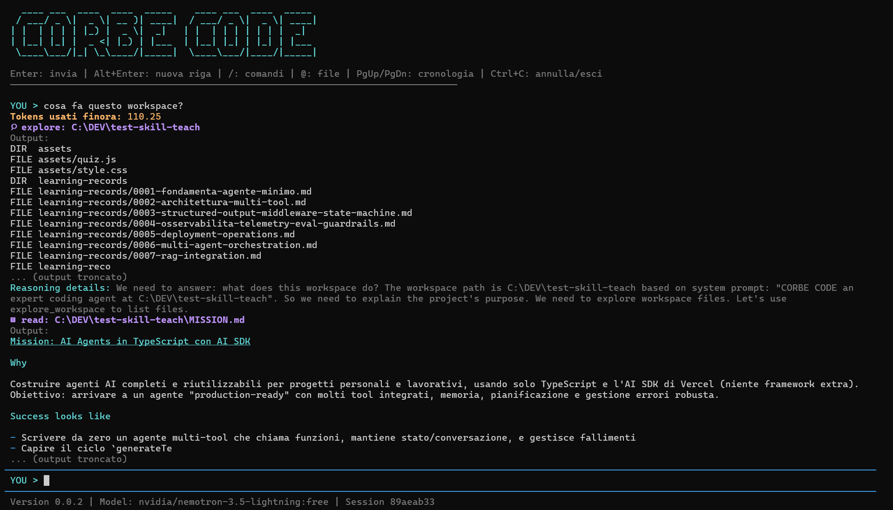

# Corbe Code



Coding agent da terminale per esplorare e modificare un workspace con OpenRouter, OpenAI, Anthropic, Google Gemini e server OpenAI-compatible, tramite Vercel AI SDK.

## Configurazione

Richiede Node.js 22.19 o successivo, npm e un terminale interattivo.

Installa e avvia dalla cartella del progetto:

```sh
npm install
npm run dev
```

Per usare un workspace diverso, aggiungi `--workspace <percorso>`.

Nella chat, esegui `/login` per configurare un provider e `/models` per scegliere il modello. `Alt+R`, al prompt della chat, apre il selettore del reasoning senza perdere il testo in composizione. La scelta globale di provider, modello e reasoning viene ripristinata al riavvio e usata anche da subagent, workflow e compressione.

I dati personali vengono salvati fuori dal workspace: in Windows sotto `%USERPROFILE%\.corbecode`, su macOS e Linux sotto `~/.config/corbecode` (rispettando `XDG_CONFIG_HOME` se impostata). Le sessioni sono conservate in `sessions/<nome-progetto>-<hash-percorso>` per restare separate anche tra progetti omonimi; quelle già presenti in `.corbecode` o nella precedente cartella globale basata solo sull'hash vengono copiate senza rimuovere l'origine. Agenti e skill vengono caricati sia dalla cartella globale (`agents/` e `skills/`) sia da `.corbecode` nel workspace, dove una definizione locale prevale su quella globale. Workflow e configurazioni specifiche del progetto restano nel workspace.

### Credenziali e override

Il file globale `config.json` conserva le chiavi dei provider e la selezione corrente. Le chiavi sono **in chiaro**: non condividere il file. L'inserimento e' mascherato, senza copia nella conversazione o nella cronologia dell'editor. Il salvataggio e' atomico; su POSIX il file viene creato con permessi `0600`, su Windows eredita le ACL della cartella utente.

`/login` verifica la credenziale prima del salvataggio. Un errore di autenticazione non sostituisce la configurazione; per problemi di rete o cataloghi non disponibili puoi scegliere esplicitamente di salvare senza verifica. `Esc` annulla. Ripetendo il login puoi sostituire una chiave; un campo vuoto conserva quella gia' salvata. Gli altri provider restano invariati.

Il file `.env` e' facoltativo. Le variabili d'ambiente prevalgono sulla configurazione globale:

```env
OPENROUTER_API_KEY=la-tua-api-key
# Alternative: OPENAI_API_KEY, ANTHROPIC_API_KEY,
# GOOGLE_GENERATIVE_AI_API_KEY oppure GEMINI_API_KEY
# Override facoltativi: rimuovili per usare la scelta salvata da /models
CORBECODE_PROVIDER=openrouter
MODEL=provider/model
TAVILY_API_KEY=tvly-la-tua-api-key
```

`MODEL` senza un provider salvato usa OpenRouter, come nelle versioni precedenti. Gli override del modello sono segnalati all'avvio e dopo `/models`; il footer mostra la selezione effettiva. `/login` segnala quando una chiave d'ambiente prevale su quella appena salvata.

### Modelli locali e provider personalizzati

In `/login` scegli **Ollama locale** (URL predefinito `http://localhost:11434/v1`) oppure **Aggiungi endpoint OpenAI-compatible**. Puoi salvare piu' server con nomi diversi, per esempio Ollama e LM Studio. Per i server locali la chiave e' facoltativa; non vengono riutilizzate automaticamente le credenziali OpenAI.

Imposta la finestra di contesto effettivamente configurata sul server, non il massimo teorico del modello; il valore prudenziale iniziale e' 4096 token. La soglia di compressione usa il 60% della finestra nota, fino al limite preesistente di 50.000 token; la stima dei token rimane approssimativa.

Ollama deve essere gia' avviato. Scarica i modelli esternamente, ad esempio:

```sh
ollama pull qwen3:8b
```

`/models` recupera i cataloghi via API e permette la ricerca per nome o ID. I cataloghi restano in memoria; `/models refresh` li ricarica. Se un provider fallisce, viene mostrato l'errore e gli altri rimangono disponibili. Puoi inserire manualmente un ID e la sua finestra di contesto quando il catalogo non e' disponibile.

I modelli senza tool calling dichiarato vengono esclusi o rifiutati alla selezione. Dove il catalogo non dichiara questa capacita', viene mostrato un avviso: la compatibilita' non e' garantita. Per Ollama viene interrogato anche `/api/show`.

Il reasoning usa i metadati disponibili e una piccola mappa di modelli documentati per i provider che non espongono i livelli. I modelli sconosciuti mantengono i default del provider (`N/A` nel footer). Le opzioni possono essere livelli, on/off oppure budget espliciti in token, secondo provider, modello e versione del server. Cambiando modello, una scelta non compatibile torna a `Default` con avviso. `Alt+R` non cambia impostazioni durante generazioni o approvazioni.

Quando il provider espone reasoning testuale o riassunti nello stream, la UI li mostra nell'ordine di arrivo sotto una label distinta, prima della risposta quando arrivano prima del testo. Vale anche per i subagent; non vengono ristampati a fine step ne' mostrati metadati cifrati o firme.

Il footer mostra a destra in giallo `Input`, `Output` e `Total` dell'ultimo turno di chat completato, senza aggiungere una riga Usage alla conversazione. Include gli step del modello principale e le continuazioni dopo le approvazioni, non il consumo separato di subagent o compressione. Non e' un cumulativo della sessione: al riavvio, alla creazione o al ripristino di una sessione il contatore e' vuoto fino al prossimo turno completato. La stima del contesto "Tokens usati finora" resta distinta dal consumo riportato dal provider. Il footer rimane su una riga, dando priorita' ai conteggi e troncando i contenuti se lo spazio non basta.

### Modelli preferiti e cambio rapido

Seleziona un modello con `/models`, poi usa `/models favorites` per aggiungerlo alla lista globale ordinata. Ripeti per gli altri modelli: il menu permette anche di rimuovere le voci o spostarle prima/dopo. Aggiungere nuovamente la stessa coppia provider/modello ne aggiorna i metadati senza duplicarla; rimuovere un preferito non cambia il modello corrente. `Esc` chiude il menu o torna dalla modifica alla lista; le operazioni gia' confermate sono salvate.

Al prompt della chat, `Alt+M` passa al prossimo preferito senza perdere il testo in composizione. `/models next` offre la stessa funzione quando il terminale intercetta lo shortcut. Dopo l'ultimo si torna al primo; se il modello corrente non e' nella lista si parte dal primo. Una lista vuota produce un avviso, una sola voce gia' attiva non cambia nulla.

La lista e' conservata nel campo `modelCycle` del `config.json` globale, insieme alle impostazioni esistenti. Puoi anche modificarla a mano:

```json
{
  "modelCycle": [
    { "provider": "openrouter", "model": "anthropic/claude-sonnet-4.5" },
    { "provider": "ollama", "model": "qwen3:8b" }
  ]
}
```

Il frammento mostra solo il nuovo campo: non sostituire l'intero file perdendo provider e credenziali. Gli ID sono esempi e devono essere disponibili sul server. `provider` e' l'ID della connessione configurata, non necessariamente il tipo o il nome visualizzato; piu' endpoint dello stesso tipo restano distinti. Gli ID dei modelli possono contenere `/`. Le coppie duplicate sono rifiutate.

Le voci aggiunte dal menu conservano anche `contextWindow` e `control`, quando noti, ma non un reasoning dedicato. Il cambio riutilizza cataloghi in memoria e metadati salvati, senza richieste di rete. Per aggiornare i dati, usa `/models refresh` e riseleziona il modello; i preferiti corrispondenti vengono aggiornati. Per voci manuali senza metadati si usano le informazioni note del provider/modello o un contesto prudenziale di 8192 token, ulteriormente limitato dall'eventuale configurazione del server. Il reasoning precedente viene mantenuto solo se supportato, altrimenti torna a `Default` con avviso.

Il footer e la selezione globale persistente vengono aggiornati immediatamente; il nuovo modello vale dalla prossima richiesta, anche per subagent, workflow e compressione. Lo shortcut e' disabilitato durante generazioni, approvazioni e selettori. `MODEL` o `CORBECODE_PROVIDER` bloccano il ciclo con un messaggio esplicito: rimuovili per usare i preferiti.

Cambiare provider significa inviare il contesto della conversazione al nuovo destinatario dalla richiesta successiva; il cambio viene annunciato e non invia richieste da solo. Un contesto piu' piccolo puo' richiedere compressione. Credenziali mancanti o provider sconosciuti impediscono il cambio senza modificare la selezione corrente; raggiungibilita', accesso al modello e compatibilita' effettiva si verificano alla richiesta, senza fallback automatico ad altri provider. Se avvii piu' CLI, condividono la selezione globale; i salvataggi sono atomici ma non coordinano scritture concorrenti tra processi.

### Memoria di lungo periodo

Il tool `memory` gestisce preferenze e note durevoli come chiave-valore in Markdown, con scope obbligatorio:

- `global`: `memory.md` nella directory globale dell'app, per preferenze valide in tutti i progetti.
- `project`: `.corbecode/memory.md` nel workspace, per preferenze specifiche del progetto.

Puoi chiedere, ad esempio, "Ricorda globalmente che preferisco risposte in italiano", "Per questo progetto ricorda di usare npm", "Mostra la memoria globale" oppure "Dimentica la preferenza di progetto tooling.package-manager". Non servono nuovi slash command: l'agente usa le operazioni `set`, `list` e `delete`.

L'agente principale puo' salvare autonomamente preferenze esplicite e durevoli quando lo scope e' chiaro; deve chiedere se e' ambiguo. Non deve dedurre preferenze da comportamenti, file o risultati dei tool, ne' salvare credenziali, segreti, dati personali/sensibili o stato temporaneo dei task. Le cancellazioni richiedono una richiesta dell'utente. Queste regole guidano l'agente: non sono un classificatore automatico dei contenuti.

Il formato e' modificabile a mano, con una voce per riga:

```markdown
# User memory

- response.language: italiano
- coding.style: modifiche minime e riuso delle soluzioni esistenti
```

Le chiavi usano lettere minuscole, numeri, punti, trattini o underscore, iniziano con una lettera e hanno al massimo 100 caratteri. I valori sono testo su una sola riga, fino a 1000 caratteri; ogni file ha un limite di 16 KiB per contenere il contesto. Un `set` sulla stessa chiave sostituisce il valore, senza duplicati. File malformati, chiavi duplicate e limiti superati producono un errore, senza sovrascritture o troncamenti silenziosi.

Le due memorie sono rilette nelle nuove richieste della chat e dei subagent; a parita' di chiave prevale il progetto. Restano separate dalla cronologia e quindi sopravvivono a nuove sessioni e compressioni. Sono preferenze, non autorizzazioni: richieste esplicite e istruzioni del repository prevalgono. Le regole condivise dai collaboratori rimangono in `AGENTS.md`.

Il tool e' disponibile solo all'agente principale, anche durante una discussione di workflow. I subagent ricevono il contesto e l'istruzione di non modificare i file di memoria nemmeno attraverso altri tool. I comandi shell non sono una sandbox e restano soggetti alle normali approvazioni.

La memoria di progetto e i suoi file temporanei vengono esclusi da Git tramite `.corbecode/.gitignore`, preservando le regole esistenti. Se il file e' gia' tracciato, l'agente rifiuta di modificarlo: rimuovilo dall'indice con `git rm --cached -- .corbecode/memory.md` prima di continuare. Non usare `git add -f` per la memoria privata. I collegamenti simbolici sui file o sulle directory di memoria sono rifiutati per evitare accessi fuori scope.

Se i percorsi globale e di progetto coincidono (per esempio avviando dalla home su Windows), la memoria globale rimane disponibile; il contesto segnala che lo scope di progetto non e' disponibile e le relative operazioni restituiscono un errore, senza mescolare i dati.

I salvataggi sono atomici e usano gli stessi permessi privati della configurazione. Il Markdown e' in chiaro; non condividerlo. Gli aggiornamenti sono serializzati nel singolo processo, non tra piu' istanze dell'app in scrittura contemporanea.

## Funzionalità

- Chat in streaming con cronologia persistente e ripresa delle sessioni.
- Memoria globale e di progetto per preferenze esplicite e durevoli, tramite il tool `memory`.
- Esplorazione, ricerca e lettura dei file; modifiche e comandi shell richiedono approvazione.
- Ricerca web ed estrazione di pagine tramite Tavily, se configurato `TAVILY_API_KEY`.
- Subagent e agenti custom definiti nel workspace; `AGENTS.md` viene aggiunto al contesto quando presente.
- Workflow espliciti per pianificare, approvare, implementare e verificare una change.
- Interfaccia terminale con Markdown, selezione di file tramite `@` e cronologia navigabile.
- Agent Skills: elenca le skill disponibili per l'agente, incluse quelle definite nel workspace e i tool integrati.

## Comandi

**CLI**

```sh
corbecode [--workspace <percorso>]
corbecode --help
corbecode --version
```

**Chat**

- `/login`: configura o aggiorna le credenziali di un provider.
- `/models [refresh|next|favorites]`: seleziona provider e modello; `refresh` aggiorna i cataloghi, `next` passa al prossimo preferito, `favorites` gestisce la lista ordinata globale.
- `/new`, `/sessions`, `/restore <id>`: crea, seleziona o ripristina una sessione.
- `/compress`: comprime la cronologia attiva.
- `/skills`: elenca le skill; `/verbose`: mostra o nasconde i dettagli dei tool.
- `/quit` o `/exit`: chiude la CLI.
- `Enter` invia, `Alt+Enter` inserisce una riga, `Alt+M` passa al prossimo modello preferito e `Alt+R` seleziona il reasoning al prompt della chat, `Ctrl+C` interrompe la richiesta corrente.

**Workflow**

- `/flow:explore <idea>`: esplora un'idea senza implementarla.
- `/flow:propose <richiesta>`: prepara una change e il relativo piano.
- `/flow:update <modifica>`: aggiorna il piano; `/flow:apply` lo approva e avvia il lavoro.
- `/flow:review`: richiede una review; `/flow:list` elenca le change.
- `/flow:resume [id]`: riprende una change; `/flow:pause` la sospende.
- `/flow:end`: chiude la change corrente.
